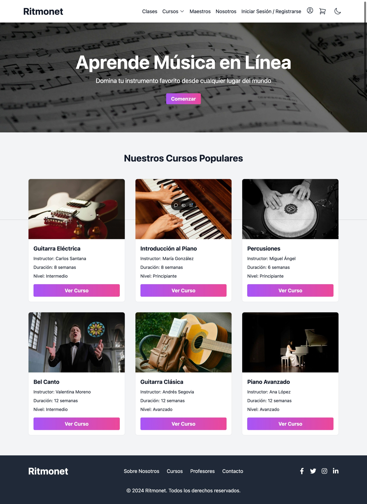

<div align="center">

# 🎵 Ritmonet

**Plataforma de educación musical en línea para la comunidad hispanohablante**



[](https://reactjs.org/)
[](https://vitejs.dev/)
[](https://tailwindcss.com/)
[](https://vercel.com/)

</div>

---

## 📖 Descripción

**Ritmonet** es una plataforma web diseñada para ofrecer educación musical de calidad a la comunidad hispanohablante. A diferencia de otras opciones existentes, Ritmonet combina cursos interactivos, teoría musical y herramientas avanzadas de aprendizaje, adaptadas cultural y económicamente al público hispano.

Nuestro objetivo es **cerrar la brecha educativa** ofreciendo una solución accesible y completa que incluya ejercicios en línea, evaluaciones y recursos multimedia, todo en un entorno diseñado para fomentar el desarrollo musical.

> [!NOTE]
> Esta versión es una **demo dinámica**, desarrollada para mostrar las posibilidades técnicas y pedagógicas de la plataforma.

---

## ✨ Características Principales

| Característica | Descripción |
|---|---|
| 🎸 **Catálogo de Cursos** | Cursos organizados por instrumento: Guitarra, Piano, Batería y Técnica Vocal |
| 👨‍🏫 **Perfiles de Maestros** | Directorio de instructores con especialidad y biografía |
| 🛒 **Carrito de Compras** | Flujo completo de selección, carrito y pago de cursos |
| 💳 **Planes de Suscripción** | Selección de plan, curso, maestro y resumen de compra |
| 👤 **Sistema de Usuarios** | Registro, inicio de sesión y perfil de usuario con cursos adquiridos |
| 🌙 **Modo Oscuro** | Alternancia entre temas claro y oscuro |
| 📱 **Diseño Responsivo** | Interfaz adaptable a dispositivos móviles y de escritorio |
| 📬 **Formulario de Contacto** | Canal de comunicación directa con el equipo |

---

## 🛠️ Stack Tecnológico

- **Frontend:** [React 18](https://reactjs.org/) con JSX
- **Build Tool:** [Vite 5](https://vitejs.dev/) + [SWC](https://swc.rs/) (compilación ultrarrápida)
- **Estilos:** [Tailwind CSS 3](https://tailwindcss.com/)
- **Routing:** [React Router DOM v6](https://reactrouter.com/)
- **Iconos:** [React Icons](https://react-icons.github.io/react-icons/) · [Heroicons](https://heroicons.com/)
- **Linting:** [ESLint 9](https://eslint.org/)
- **Deploy:** [Vercel](https://vercel.com/)

---

## 📁 Estructura del Proyecto

```
ritmonetdeploy/
├── public/
│   └── assets/              # Imágenes y recursos estáticos
├── src/
│   ├── components/          # 27 componentes React
│   │   ├── NavBar.jsx       # Barra de navegación con modo oscuro
│   │   ├── Hero.jsx         # Banner principal con CTA
│   │   ├── HomePage.jsx     # Página de inicio
│   │   ├── CoursesHome.jsx  # Página principal de cursos
│   │   ├── CoursesPage.jsx  # Cursos filtrados por instrumento
│   │   ├── CourseDetails.jsx # Detalle individual del curso
│   │   ├── CourseCard.jsx   # Tarjeta de curso reutilizable
│   │   ├── Teachers.jsx     # Listado de maestros
│   │   ├── TeacherDetails.jsx # Perfil detallado del maestro
│   │   ├── Subscription.jsx # Planes de suscripción
│   │   ├── Cart.jsx         # Carrito de compras
│   │   ├── PaymentForm.jsx  # Formulario de pago
│   │   ├── LoginRegister.jsx # Inicio de sesión y registro
│   │   ├── Profile.jsx      # Perfil del usuario
│   │   ├── AboutUs.jsx      # Sobre nosotros
│   │   ├── Contact.jsx      # Formulario de contacto
│   │   ├── Footer.jsx       # Pie de página
│   │   └── ...              # Más componentes
│   ├── context/
│   │   └── UserContext.jsx  # Estado global del usuario (React Context)
│   ├── data/
│   │   ├── CoursesData.json     # Catálogo completo de cursos
│   │   ├── PlansData.json       # Planes de suscripción
│   │   ├── PopularCourses.json  # Cursos destacados
│   │   └── TeachersData.json    # Información de maestros
│   ├── utils/
│   │   └── slugify.js       # Utilidad para generar URLs amigables
│   ├── App.jsx              # Componente raíz con rutas
│   ├── main.jsx             # Punto de entrada de la aplicación
│   └── index.css            # Estilos globales
├── index.html               # HTML base
├── vite.config.js           # Configuración de Vite
├── tailwind.config.js       # Configuración de Tailwind CSS
├── vercel.json              # Configuración de deploy en Vercel
└── package.json             # Dependencias y scripts
```

---

## 🚀 Instalación y Ejecución

### Prerrequisitos

- [Node.js](https://nodejs.org/) v18 o superior
- [npm](https://www.npmjs.com/) v9 o superior

### Pasos

```bash
# 1. Clonar el repositorio
git clone https://github.com/hiramAcevedo/ritmonetdeploy.git

# 2. Entrar al directorio del proyecto
cd ritmonetdeploy

# 3. Instalar dependencias
npm install

# 4. Iniciar el servidor de desarrollo
npm run dev
```

La aplicación estará disponible en `http://localhost:5173`

### Scripts Disponibles

| Script | Comando | Descripción |
|---|---|---|
| Desarrollo | `npm run dev` | Inicia el servidor de desarrollo con HMR |
| Build | `npm run build` | Genera la versión de producción |
| Preview | `npm run preview` | Previsualiza el build de producción |
| Lint | `npm run lint` | Ejecuta ESLint para análisis de código |

---

## 🗺️ Rutas de la Aplicación

| Ruta | Página |
|---|---|
| `/` | Página de inicio |
| `/courses` | Catálogo de cursos por instrumento |
| `/courses/:instrumento` | Cursos filtrados por instrumento |
| `/courses/:instrumento/:courseId` | Detalle del curso |
| `/teachers` | Directorio de maestros |
| `/teachers/:id` | Perfil del maestro |
| `/subscription` | Planes de suscripción |
| `/login` | Inicio de sesión / Registro |
| `/profile` | Perfil del usuario |
| `/acquired-courses` | Cursos adquiridos |
| `/cart` | Carrito de compras |
| `/payment` | Formulario de pago |
| `/contact` | Formulario de contacto |
| `/about-us` | Sobre nosotros |

---

## 🌐 Deploy

La aplicación está configurada para desplegarse en **Vercel** con soporte para SPA (Single Page Application) mediante rewrites en `vercel.json`.

---

## 👥 Equipo 3

| Rol | Nombre |
|---|---|
| 👨‍💻 Desarrollador | **Hiram Agustín Acevedo López** |
| 👨‍💻 Desarrollador | **Luis Fernando Moreno López** |
| 👩‍🏫 Asesora | **Elizabeth Cristina Hernández Hernández** |

---

## 📄 Licencia

Este proyecto fue desarrollado con fines académicos y demostrativos.

---

<div align="center">

Hecho con ❤️ por el **Equipo 3** · Ritmonet © 2024

</div>
